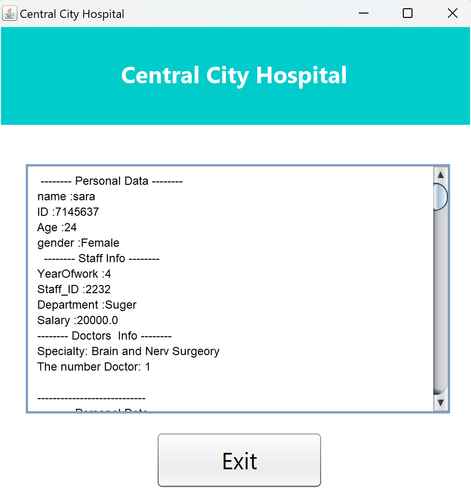
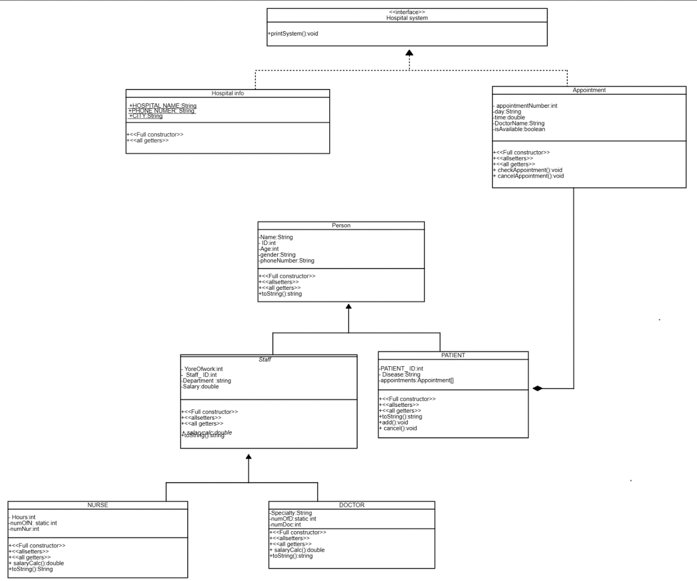

# Hospital Management System

A Java desktop application for managing a hospital's patients, staff, and appointments, built with **object-oriented programming** principles and a **Swing GUI**.

> Team project, Programming Language 2 course (CS 111T), Princess Nourah bint Abdulrahman University, Spring 2024.



## Features

- Display hospital information
- Register patients and book, check, or cancel appointments
- Show staff information and calculate salaries
- Save records to a text file and read them back
- Graphical interface built with Java Swing

## OOP Concepts Used

| Concept | Where |
|---|---|
| Interface | `HospitalSystem`, implemented by `HospitalInfo` and `Appointment` |
| Inheritance | `Person` → `Patient`, `Staff` → `Doctor`, `Nurse` |
| Abstract class | `Staff` with the abstract method `SalaryCalc()` |
| Polymorphism | Salary calculated through `Staff` references |
| Composition | `Patient` holds an array of `Appointment` objects |
| Exception handling | Input validation and file errors |
| File I/O | `Write` and `Read` classes |

## My Role

- Built the abstract **`Staff`** class (extends `Person`) and the **`Doctor`** subclass
- Implemented **polymorphic salary calculation** through `SalaryCalc()`
- Implemented **exception handling** in the `Appointment` logic
- Implemented **file writing and reading**

## Class Diagram



## How to Run

Requires **JDK 21** (the code uses Java text blocks).

**NetBeans:** open the project folder, then Run.

**Command line:**
```bash
javac -d out src/hospitalsystem/*.java
java -cp out hospitalsystem.Main
```

## Team

Lina Alsarhan, Asayel Alotaibi, Shahad Alshamrani, Sarah Alnowaiser
